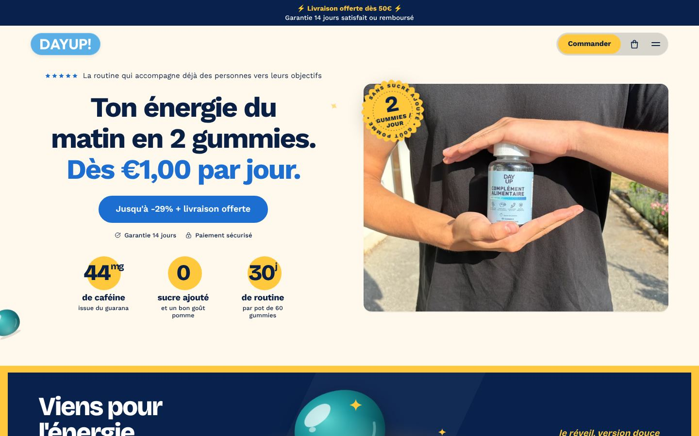
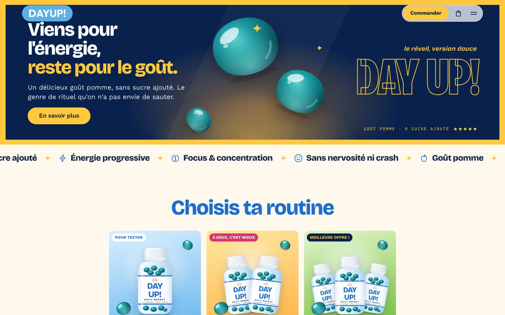
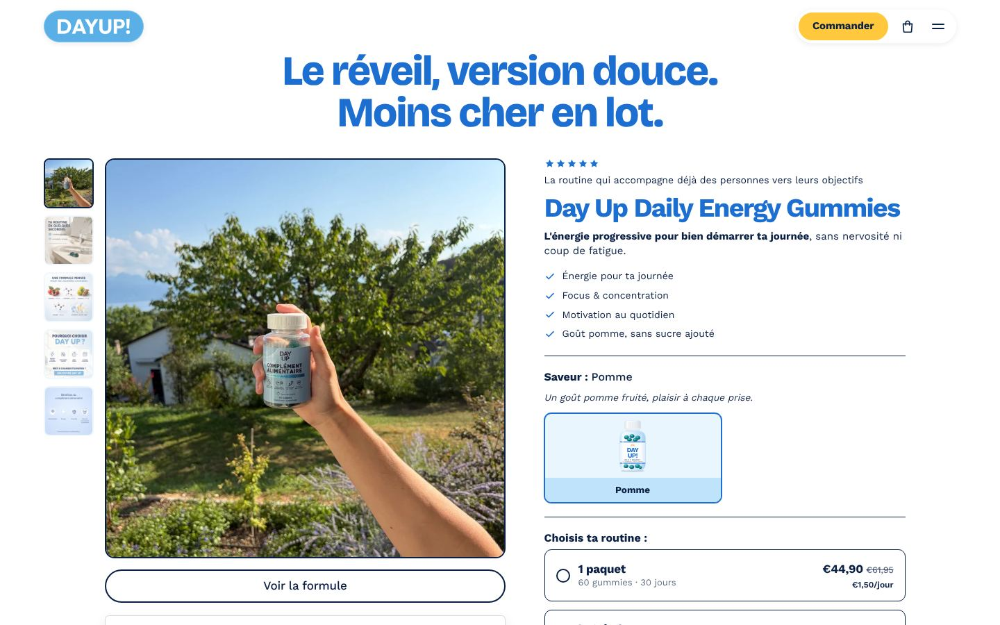
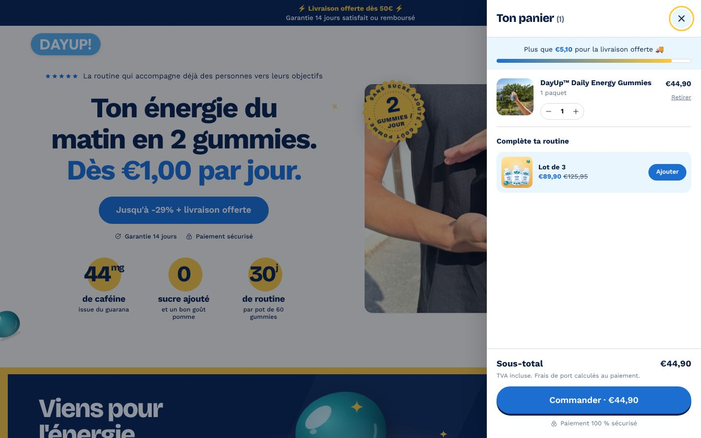
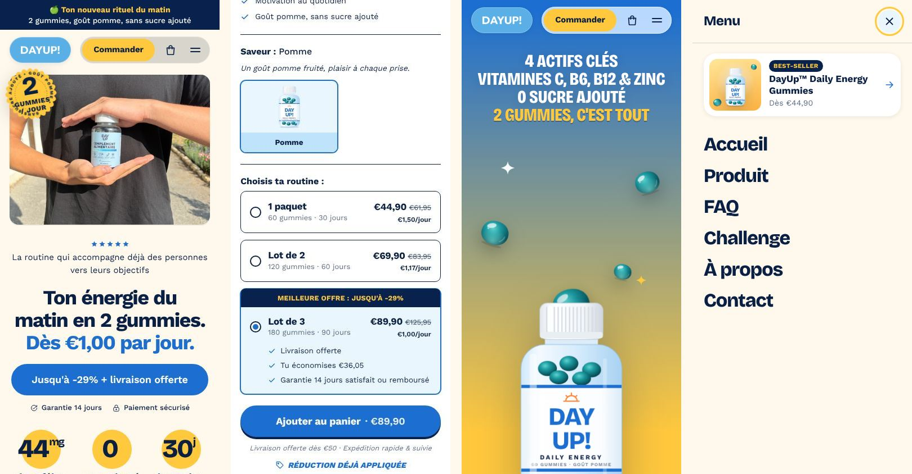

# Day Up — Shopify theme

A complete Shopify Online Store 2.0 theme for **[dayup-shop.com](https://dayup-shop.com)**.
Its layout, section order and interactions follow **gruns.co**, rebuilt for the Day Up brand:

- **Colours:** sky blue from the logo, sunrise yellow and a "morning light" cream, in place of Grüns' green, yellow and cream.
- **Content:** your own photos and tester videos.
- **Prices:** your real bundles (1 pot / lot de 2 / lot de 3).
- **Copy:** in French, using only claims that Day Up already makes on its site and packaging.

| | |
|---|---|
|  |  |
|  |  |
|  |  |



---

## Install it on your store (2 options)

### Option A: upload the zip (easiest)
1. Download [`dist/dayup-theme.zip`](dist/dayup-theme.zip).
2. In Shopify admin, go to **Online Store → Themes → Add theme → Upload zip file** and choose the zip.
3. Click **Customize** to check everything, then **Publish** when you're happy. Your current theme stays available in your theme library.

### Option B: connect this GitHub repo (stays in sync)
1. Go to **Online Store → Themes → Add theme → Connect from GitHub**.
2. Pick `uixfred-boop/videoprojet` and the branch you want.
3. Every push to that branch updates the theme. Edits made in the theme editor are committed back.

> Non-theme folders (`tools/`, `docs/`, `dist/`) are ignored by Shopify.

---

## After installing: 10-minute checklist

1. **Pages.** Open your *FAQ* page and set its template to **`page.faq`**. Set your *Contact* page's template to **`page.contact`**. Create either page if it doesn't exist yet (handles `faq` and `contact`).
2. **Menus.** The header drawer uses **main-menu**, and the footer columns use **main-menu** and **footer**. Edit them in *Content → Menus*.
3. **Images.**
   - The theme points to the images already in your store (`IMG_7147.jpg`, `IMG_7143.jpg`, `IMG_7138.jpg`, `DAYUP.png`, …) and to your existing tester videos.
   - If any block shows a placeholder, pick the image again in the theme editor.
4. **Social links.** Add them in *Theme settings → Réseaux sociaux*. Icons only appear once a link is set.
5. **Reviews.**
   - With an app that fills Shopify's standard `reviews` metafields (Judge.me, Shopify Product Reviews…), **the real rating and review count appear automatically**: next to the stars, in the buy box and in the final CTA.
   - Without one, a neutral sentence is shown. No invented numbers.
   - Judge.me's full widget is picked up by the *Avis clients (app)* section on the product page.
6. **Check the claims** against your label: ingredient doses, ≈44 mg caffeine, "sans sucres ajoutés", the 14-day guarantee and the free-shipping threshold. Everything is editable in the theme editor.
7. **Optional:** upload a **transparent PNG packshot** in *Animation au scroll*, *Promo lot* or *Appel à l'action final* to replace the illustrated bottle.

### Automatic prices
Text fields accept tokens that are calculated from your real prices, so they never go out of date:

| Token | Example | Meaning |
|---|---|---|
| `[prix_jour]` | €1,00 | lowest price per day (bundle price ÷ days) |
| `[prix_min]` | €44,90 | lowest bundle price |
| `[remise_max]` | 29% | biggest saving vs. compare-at price |
| `[livraison]` | €50 | free-shipping threshold (theme setting) |

- Per-day price and gummy counts use *Theme settings → Produit & offres*: 30 days and 60 gummies per pot.
- The number of pots per bundle is read from the variant name ("LOT DE 3" → 3). You can override it with a `custom.packs` variant metafield.

---

## How the page maps to gruns.co

| gruns.co | Day Up section (`sections/…`) |
|---|---|
| 2-line rotating announcement bar | `announcement-bar` |
| Floating pill header (logo pill · "Shop Now" · bag · ☰) + side menu | `header` |
| Hero: stars, big headline + price, CTA, 3 yellow-circle stats, photo + sticker | `hero` |
| "Come for the Gummies" dark band in a yellow frame | `promo-banner` |
| Press-logo strip | `marquee` (benefits; also accepts real logos) |
| "Find Your Flavor" product tiles | `offers-grid` (your 3 bundles, illustrated pots) |
| "We made daily nutrition ridiculously easy" cards | `value-cards` |
| Sticky scroll scene (pack rises, stats appear, green→yellow) | `scroll-story` (bottle, blue→sunrise) |
| "3rd-party tested" dark band with 4 tiles | `trust-band` (your actives and doses) |
| Buy box: gallery, flavour, bundle cards with ribbon, per-day price, perks, accordions, "Tastes like" / "Packed with" | `featured-product` / `main-product` (shared `snippets/buybox.liquid`) |
| "Same Grüns. New lower price." yellow band | `promo-split` |
| "1 million members" fanned photos | `community-fan` |
| Reviews | `video-testimonials` (your real tester videos) + `reviews-widget` (Judge.me) |
| Final dark CTA with gradient card | `cta-band` |
| Footer: signup, link columns, disclaimers, giant wordmark | `footer` |
| Product page: split card, stats card, Us vs Them, FAQ | `split-card`, `steps-stats`, `comparison`, `faq` |
| Cart drawer + sticky add-to-cart bar | `cart-drawer` (free-shipping progress + bundle upsell), sticky bar in buy box |

**What was deliberately not copied:** Grüns' logos, mascot, photos, press mentions, review counts, lab-testing and clinical claims. Those belong to Grüns, or would be untrue for Day Up.

---

## Developing locally (optional)

```bash
cd tools
npm install
npm run preview   # renders the theme with your real product data → http://localhost:4321
npm run check     # Shopify Theme Check (currently 0 offenses)
npm run zip       # rebuilds dist/dayup-theme.zip
```

The preview (`tools/preview/`) is an approximation of Shopify built with liquidjs. The real cart and checkout only run on Shopify.

### Structure
```
assets/      base.css, sections.css, theme.js, self-hosted fonts (Bricolage Grotesque, Work Sans)
config/      theme settings (colours, offer maths, social links)
layout/      theme.liquid, password.liquid
locales/     fr.default.json (default), en.json
sections/    all sections + header/footer groups
snippets/    buybox, media, offer-card, bottle/gummy/sticker illustrations, icons…
templates/   index, product, page.faq, page.contact, cart, collection, customers/*, …
```
